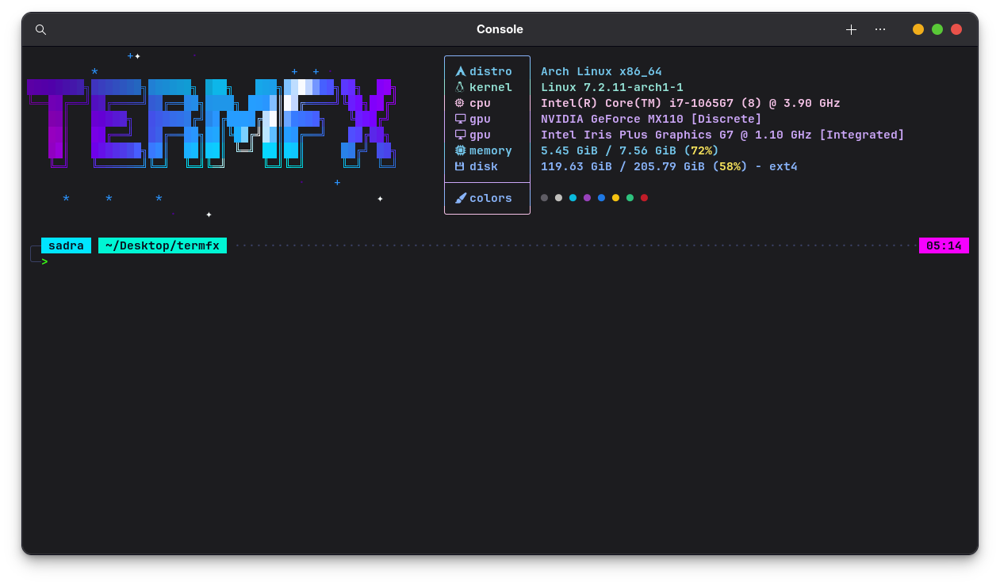

<p align="center">
  
</p>

# termfx

**An animated ASCII header for your terminal, plus a modern shell look.** Every time you open a terminal you get a living picture (aurora, fire, matrix rain, 70+ more) next to a panel with your system info, and a good-looking prompt underneath. Works in **Bash and Zsh on Linux**. The animation engine needs only Python 3's standard library: no downloads, no GPU.

- 76 animated effects (plus `random`), 66 colour palettes, any colour you like
- your own ASCII art (any size, even animated), shrunk to fit automatically, never overlapping the info panel
- system info panel (Fastfetch presets), Starship prompt themes, profiles you can save and share
- everything changes **live**: no restart needed

> **New here?** Read [Part 1: Zero to hero](#part-1-zero-to-hero-for-complete-beginners). It takes about 10 minutes. Already know what you want? Jump to [Part 2: Every command](#part-2-every-command).

---

# Part 1: Zero to hero (for complete beginners)

You do not need to know anything about terminals to follow this. Anything written in a `grey box` is something you type, then press **Enter**.

## Step 0: What is a terminal?

The terminal is the black window where you type commands (Terminal, Konsole, GNOME Terminal, Alacritty, kitty, Ghostty, ...). termfx lives in that window. Open one now. Everything below is typed there.

## Step 1: Install it

1. Download **`termfx-install.sh`** (from the project's `dist/` folder or release page) into your Downloads folder.
2. Open a terminal in that folder and run:

```sh
sh termfx-install.sh
```

3. The installer asks a few questions. You can just press **Enter** for each one to accept the default, or pick from the menus:
   - **Art**: which picture to show (pick a number)
   - **Effect**: which animation (pick a number or a name; Enter = `aurora`)
   - **Palette**: which colours (Enter = `auto`, the best colours for the effect)
   - **Panel**: how the system info looks
4. It may ask for your password (to install helper programs like Fastfetch and Starship). That is normal. All of them are optional.
5. **Close the terminal and open a new one.** Your header appears.

Want it fully automatic? `sh termfx-install.sh -y` accepts every default and asks nothing.

> Do not pipe the installer into a shell (`curl ... | sh`). Save the file first, then run it.

> Your old setup is **backed up automatically**. You can get it back any time with `termfx restore`.

## Step 2: Nothing showing?

Run:

```sh
termfx doctor
```

It tells you what is wrong in plain words. The two most common reasons:

| What you see | Why | Fix |
|---|---|---|
| No header at all | The terminal window is too small (needs about 80 columns x 24 rows) | Make the window bigger, or `termfx set min_cols 60` and `termfx set min_rows 20` |
| Header but weird boxes instead of icons | No "Nerd Font" in your terminal | Install *JetBrainsMono Nerd Font* and select it in the terminal's settings, or run `termfx set icons false` |

## Step 3: Change the animation

```sh
termfx effect list          # see ALL effects: a numbered menu with colours
termfx effect fire          # switch to "fire"  (applies instantly)
termfx effect 12            # or pick by its number from the list
termfx effect next          # next effect (also: prev)
termfx effect random        # a different random effect on every new terminal
termfx effect info fire     # details about one effect
termfx preview effect=vortex  # full-screen try-out WITHOUT changing anything (press any key to leave)
```

**Don't want any animation?** (looks clean, uses no CPU)

```sh
termfx effect off           # still picture, no animation
termfx effect on            # animation back, with the effect you had before
```

## Step 4: Change the colours

```sh
termfx palette list         # 66 palettes as a numbered menu with colour swatches
termfx palette sunset       # use one by name
termfx palette 7            # or by number
termfx palette show sunset  # preview the gradient first
termfx palette auto         # let termfx choose the best colours for the effect
termfx palette colors       # list plain colour names (red, cyan, hotpink ...)
termfx palette white        # a single solid colour
termfx palette "#ff0080,#00e5ff,#7a00ff"   # your own colours (any hex codes)
```

Lost? `termfx palette next` and `termfx palette prev` flip through them one by one. Found a combination you love? Save it ([Step 9](#step-9-save-your-look)).

## Step 5: Change the picture (art)

```sh
termfx art list                    # installed art (numbered)
termfx art use arch                # switch art by name (or number: termfx art use 2)
termfx art use random              # random art each time
termfx art add mylogo logo.txt -u  # import YOUR text file and use it (-u = use it now)
termfx art add mylogo -u           # paste art in the terminal; finish with Ctrl-D
termfx art edit mylogo             # edit it in your editor
termfx art image face photo.png    # turn a picture into ASCII (needs chafa or jp2a)
termfx art text banner "HELLO"     # big text banner (needs figlet or toilet)
termfx art distro                  # your Linux distribution's logo (needs fastfetch)
termfx art info mylogo             # how it is resized to fit
termfx art rm mylogo               # delete
```

Art can be any size. termfx shrinks it to fit and **never** draws it over the info panel. For an **animated** picture, put a line `---FRAME---` between the frames in your text file.

## Step 6: Move and tune the header

```sh
termfx align center        # left | center | right
termfx set speed 1.5       # faster animation (1.0 = normal)
termfx set fps 30          # smoother (higher = more CPU, 2..60)
termfx set intensity 1.4   # brighter (0.3 .. 2.5)
termfx set sparkle true    # extra twinkles
termfx set vignette true   # darker edges, soft focus
termfx glitch on           # random glitch distortions
termfx rotate on 120       # change effect + colours every 120 seconds
```

Every setting is reachable with `termfx set NAME VALUE` (see the [config key list](#config-keys) below). Not sure of a value? `termfx get NAME` shows the current one.

## Step 7: The info panel (your system specs)

```sh
termfx info off               # hide the panel   (termfx info on  brings it back)
termfx fastfetch list         # 12 ready-made panel designs
termfx fastfetch gamer        # choose one
termfx info-style list        # frame style: boxed, clean, compact, minimal
termfx info-colors list       # colours of the panel text
termfx info-rows list         # which lines are shown (user, cpu, gpu, ...)
termfx info-rows user,distro,cpu,memory   # choose your own lines
termfx info custom "date"     # show the output of ANY command instead
termfx info refresh           # re-read the system info now
```

## Step 8: The prompt (the line where you type)

```sh
termfx theme list            # colour themes: catppuccin, nord, dracula, ... with swatches
termfx theme nord            # switch theme (header colours follow it)
termfx prompt list           # shapes: pills blocks sharp slant minimal plain
termfx prompt slant          # pick a shape
termfx char "❯"              # the prompt symbol (try: λ  $  ➜  >)
termfx lines 1               # one-line or two-line prompt
termfx clock "%H:%M:%S"      # clock with seconds   (termfx clock off  to hide)
termfx look                  # show your current look at a glance
```

Advanced users: `termfx starship ...` controls 25+ Starship options and modules ([see below](#starship-prompt)).

## Step 9: Save your look

Found a combination you love? Save it, and try new ones without fear:

```sh
termfx profile save night      # save everything as "night"
termfx randomize               # a surprise: random effect + colours + art
termfx profile load night      # go back to your saved look
termfx profile list
termfx export mylook.json      # a file you can share with a friend ...
termfx import mylook.json      # ... who loads it with this
```

## Step 10: Daily life with termfx

**What happens when I run commands?**
While a command runs, the header steps aside so the output can use the whole screen and your scrollback is never damaged. When the command ends, the header comes back at the next prompt.

**What if the output is long (e.g. `ls -R /`, `cat bigfile`)?**
If the output reaches the bottom of the screen, the header stays hidden so nothing can overlap. Type **`clear`** (or press **Ctrl-L**) and the header comes back, with your prompt right under it. That is the whole trick: *screen full? press Ctrl-L.*

**Want the header to never hide?** `termfx set pause never`

**Turn everything off for a moment / on again**

```sh
termfx off       # hide the header (new terminals; or: termfx reload)
termfx on
termfx reload    # re-read the config now
```

**Something odd?** `termfx doctor` (diagnose), `termfx status` (what is active right now), `termfx stats`.

**Get my old terminal back / remove termfx**

```sh
termfx restore             # put the backed-up setup back
termfx uninstall           # remove termfx
termfx uninstall --purge   # ...and delete its config and art too
```

## Cheat sheet (the 12 commands you will use 95% of the time)

| I want to... | Type |
|---|---|
| browse effects | `termfx effect list` |
| pick an effect | `termfx effect fire` or `termfx effect 12` |
| stop the animation / resume | `termfx effect off` / `termfx effect on` |
| browse colours | `termfx palette list` |
| pick colours | `termfx palette sunset` |
| try something without changing | `termfx preview effect=vortex` |
| change picture | `termfx art use NAME` |
| surprise me | `termfx randomize` |
| save / load a look | `termfx profile save NAME` / `termfx profile load NAME` |
| header is covered / screen is full | `clear` or **Ctrl-L** |
| something is wrong | `termfx doctor` |
| see all commands | `termfx --help` |

---

# Part 2: Every command

`NAME` is a name from a list, `N` is a number from a list, `SECS` is seconds. Most commands apply **live** in an open terminal; if one says "will apply in new terminals", open a new one or run `exec $SHELL`.

## Header: effects and colours

| Command | What it does |
|---|---|
| `termfx effect list` | numbered menu of all effects with description and recommended palette |
| `termfx effect NAME` / `termfx effect N` | set the effect (`random` = random on every new terminal) |
| `termfx effect next` / `prev` | step through the effects |
| `termfx effect info NAME` | details and recommended colours of one effect |
| `termfx effect off` (`none`, `plain`) | still art, no animation, no CPU use |
| `termfx effect on` | animation back; restores the effect you had before `off` |
| `termfx effect status` | prints `effect: on (NAME)` or `effect: off` |
| `termfx palette list` | numbered menu of all palettes with colour swatches and hex values |
| `termfx palette NAME` / `termfx palette N` | set the palette. `auto` = best for the effect |
| `termfx palette next` / `prev` | step through palettes |
| `termfx palette show NAME` | preview a palette (colour blocks + gradient + which effects use it) |
| `termfx palette colors` | list the plain colour names |
| `termfx palette white` | one solid colour: any colour name or `"#hex"` |
| `termfx palette "#hex,#hex,..."` | your own gradient (names work too: `red,white,#00e5ff`) |
| `termfx preview [key=value ...]` | full-screen try-out, e.g. `termfx preview effect=vortex palette=ocean`. Any key exits. Changes nothing |
| `termfx align left\|center\|right` | header position |
| `termfx rotate on [SECS]` / `off` | auto-change effects and colours on a timer (default 300 s) |
| `termfx glitch on\|off` | random glitch distortions (default off) |
| `termfx randomize` | instant random look: effect, palette, art, speed, intensity |

Extra eye-candy knobs (use `termfx set KEY VALUE`): `speed`, `fps`, `intensity`, `stars`, `sparkle`, `sweep`, `vignette`, `intro`, `frame_ms`.

## Header: art

| Command | What it does |
|---|---|
| `termfx art list` | installed art (numbered, current marked) |
| `termfx art use NAME\|N\|random` | switch art |
| `termfx art add NAME [-u]` | paste art (finish with Ctrl-D); `-u` = use it now |
| `termfx art add NAME FILE\|URL [-u]` | import a text file or download from a URL |
| `termfx art edit NAME` | open in `$EDITOR` (best for huge art) |
| `termfx art show NAME` | print it plainly |
| `termfx art info [NAME]` | size, frames and how it is fitted to your terminal |
| `termfx art rm NAME` | delete |
| `termfx art image NAME FILE\|URL [WIDTH]` | picture to ASCII (needs `chafa` or `jp2a`) |
| `termfx art text NAME "TEXT" [font]` | big text banner (needs `figlet` or `toilet`) |
| `termfx art distro [NAME]` | your distro's logo (needs `fastfetch`) |

Animated art: put a line `---FRAME---` between frames.

## Info panel

| Command | What it does |
|---|---|
| `termfx info on\|off` | show or hide the panel |
| `termfx info status` | current panel settings |
| `termfx info items` | list available info lines |
| `termfx info refresh` | clear the cache, re-read system info |
| `termfx info custom "CMD"` | show the output of any command |
| `termfx fastfetch list` / `NAME` / `preview NAME` | choose a Fastfetch panel design: `classic compact minimal clean full gamer server developer aesthetic hybridfetch ultra` |
| `termfx info-style list\|NAME` | frame: `boxed clean compact minimal` |
| `termfx info-colors list\|auto\|rainbow\|off\|PALETTE` | text colours of the panel |
| `termfx info-rows list\|default\|a,b,c` | choose the lines: `user hname uptime distro kernel wm desktop term shell cpu gpu disk memory packages battery local_ip` |

## Prompt and shell look

| Command | What it does |
|---|---|
| `termfx theme list\|NAME\|N` | colour theme: `catppuccin cyberpunk dracula gruvbox mono nord onedark rosepine solarized tokyonight` |
| `termfx theme new NAME [BASE]` | make your own theme (12 hex colours in a JSON file) |
| `termfx theme edit NAME` | edit your theme |
| `termfx prompt list\|NAME` | shape: `pills blocks sharp slant minimal plain` (`custom` = you edit `starship.toml`, never overwritten) |
| `termfx char "❯"` | prompt symbol |
| `termfx lines 1\|2` | one- or two-line prompt |
| `termfx clock on\|off\|"FORMAT"` | clock on the right, e.g. `"%H:%M:%S"` |
| `termfx look` | show the current look |

### Starship prompt

| Command | What it does |
|---|---|
| `termfx starship list` | show all Starship controls and values |
| `termfx starship set KEY VALUE` | change one of 25+ options, e.g. `right_prompt true`, `time_format '%H:%M:%S'`, `directory_length 5` |
| `termfx starship theme list\|NAME` | named themes: `terminal-match catppuccin-mocha tokyo-night nord-frost dracula-night gruvbox-retro rose-pine one-dark mono-ink developer-forge cloud-ops server-console neon-cyberpunk solarized-terminal plain-clean` |
| `termfx starship module list\|on NAME\|off NAME` | switch prompt modules (git, python, battery, ...) |
| `termfx starship preset NAME` | module collections: `balanced minimal developer cloud server full` |

## Profiles and sharing

| Command | What it does |
|---|---|
| `termfx profile save NAME` | save the current config as a profile |
| `termfx profile load NAME` | apply a saved profile |
| `termfx profile list` / `rm NAME` | list / delete profiles |
| `termfx export [FILE]` | export config as JSON (to the screen, or a file) |
| `termfx import FILE` | import a JSON config |

## Control, config and diagnostics

| Command | What it does |
|---|---|
| `termfx on` / `off` | enable / disable the whole header |
| `termfx reload` | re-read the config now |
| `termfx set KEY VALUE` / `termfx get KEY` | change / read any config key |
| `termfx config` | open the config file in your editor |
| `termfx status` | what is active right now |
| `termfx doctor` | diagnose terminal size, config and optional tools |
| `termfx stats` | version, config path, counts |
| `termfx notify on\|off [SECS]` | desktop notification when a command runs longer than SECS (default 10) |
| `termfx completion bash\|zsh` | print the Tab-completion script |
| `termfx version` / `termfx help` (or `--help`) | version / full help with every effect |
| `termfx restore [DIR]` | restore your previous terminal setup from the backup |
| `termfx uninstall [--purge]` | remove termfx (`--purge` also deletes config and art) |

Tab completion: installed automatically. Type `termfx ef` + **Tab**.

## Config keys

Set with `termfx set KEY VALUE`, read with `termfx get KEY`, or edit the file with `termfx config` (then `termfx reload`). The file is `~/.config/termfx/config`.

| Key | Default | Meaning |
|---|---|---|
| `enabled` | `true` | header on/off |
| `art` | `girl` | art name, a file path, or `random` |
| `effect` | `aurora` | effect name, `random`, or `off` |
| `palette` | `auto` | palette name, `auto`, or `"#hex,#hex,..."` |
| `speed` | `1.0` | animation speed multiplier |
| `fps` | `20` | frames per second, 2..60 (lower = less CPU) |
| `intensity` | `1.0` | brightness, 0.3..2.5 |
| `info` | `fastfetch` | `fastfetch` \| `auto` \| `builtin` \| `off` |
| `fetch_preset` | `classic` | Fastfetch panel design |
| `info_config` | `auto` | `auto` or a path to your own Fastfetch JSONC |
| `info_rows` | (preset) | comma-separated lines to show |
| `info_colors` | `auto` | `auto` \| `rainbow` \| palette name \| `off` |
| `info_style` | `boxed` | `boxed` \| `clean` \| `compact` \| `minimal` |
| `info_gap` | `4` | columns between art and panel |
| `info_cmd` | (empty) | custom command instead of Fastfetch |
| `max_height` | `20` | tallest header in rows (bigger art is scaled down) |
| `max_width` | `0` | 0 = automatic (about half the terminal) |
| `fit` | `auto` | `auto`/`scale` = shrink the whole art; `crop` = cut the edges |
| `crop` | `center` | with `fit=crop`: `center` \| `top` \| `bottom` |
| `min_cols`, `min_rows` | `80`, `24` | header hides itself in smaller terminals |
| `reserve` | `10` | rows always kept free for your shell |
| `intro` | `true` | reveal animation when the terminal opens |
| `stars` | `true` | twinkling stars in empty space |
| `sparkle` | `false` | denser twinkles |
| `glitch` | `false` | random glitch distortions |
| `sweep` | `true` | light sweep across the art |
| `vignette` | `false` | darkened edges |
| `frame_ms` | `140` | speed of multi-frame art |
| `pause` | `auto` | `auto` = hide while commands run; `never` = always visible |
| `align` | `left` | `left` \| `center` \| `right` |
| `rotate`, `rotate_interval` | `false`, `300` | auto-rotate effects/colours every N seconds |
| `notification`, `notify_after` | `false`, `10` | notification for long commands |
| `ui` | `true` | eza / bat / fzf aliases and key bindings |
| `prompt` | `auto` | `auto` = Starship if installed, `off` |
| `icons` | `true` | Nerd Font icons |
| `theme` | `catppuccin` | colour theme |
| `prompt_style` | `pills` | prompt shape |
| `prompt_char` | `❯` | prompt symbol |
| `prompt_lines` | `2` | 1 or 2 |
| `clock`, `clock_format` | `true`, `%H:%M` | prompt clock |
| `truecolor` | `auto` | force 24-bit colour `true` / `false` |
| `starship_*` | | Starship options (use `termfx starship`) |

**Where things live:** config `~/.config/termfx/config`, art `~/.config/termfx/art/`, profiles `~/.config/termfx/profiles/`, programs `~/.local/bin/termfx` and `termfx-engine`, cache `~/.cache/termfx/` (errors are logged in `error.log`).

---

# Part 3: Problems and answers

| Problem | Answer |
|---|---|
| The header is gone | `termfx doctor`. Usually the window is too small, or you pressed `termfx off`. Try `termfx on` |
| After a long output the header is gone | By design (so nothing overlaps). Type `clear` or press Ctrl-L |
| Letters look like boxes | Install a Nerd Font, or `termfx set icons false` |
| It uses too much CPU | `termfx effect off`, or `termfx set fps 10` |
| Colours look flat | Your terminal may not support true colour: try `termfx set truecolor false`, or use a modern terminal |
| It looks odd after resizing the window | It re-fits itself in a moment; press Enter once if the prompt looks shifted |
| I changed something and hate it | `termfx profile load NAME` (if you saved one), or `termfx randomize` for a fresh start |
| I want my old terminal back | `termfx restore` |
| I want to remove termfx | `termfx uninstall` |

---

## Requirements and optional tools

The only runtime requirements are **Bash**, **Python 3**, and standard Unix utilities (`awk`, `sed`, `grep`, `find`, `install`, `tar`, and `gzip`). The installer checks for Python 3 and installs it when system package installation is available. The Python engine imports only modules shipped with Python; there are no Python packages to download.

The installer also attempts to install these companion tools. They improve the shell experience but are optional; termfx continues to run if any are unavailable:

| Tool | Used for | If unavailable |
|---|---|---|
| Fastfetch | System-information display and distro logos | Built-in information panel is used; distro-logo lookup is unavailable |
| Starship | Configurable prompt | Existing shell prompt remains usable |
| eza | Enhanced directory listings | `ls` remains available |
| bat / batcat | Syntax-coloured file viewing | `cat` remains available |
| fzf | Interactive fuzzy selection | Non-interactive selection remains available |
| Git | fzf user-space fallback and Git prompt details | Those optional integrations are skipped |
| fontconfig and JetBrainsMono Nerd Font v3+ | Font detection and terminal icons | Icons can be disabled; select/install a current Nerd Font in the terminal if desired |
| curl or wget | Downloads for user-space fallbacks and fonts | Package-manager installs can still work; download fallbacks are unavailable |
| chafa, jp2a, figlet, toilet | Optional image and text art conversion | Those conversion commands explain which optional tool is needed |

No effect assets or other runtime dependencies are fetched. Package names differ by distribution; the installer maps common names for apt, DNF/YUM, pacman, zypper, apk, XBPS, Gentoo emerge, and Homebrew. If a companion package is missing from a repository or the CPU architecture is unsupported, the installer tries a user-local download where it has a fallback and reports any unavailable optional tool. It does not claim a failed optional install succeeded. You can inspect the result with `termfx doctor`.

## Install (all options)

```sh
sh termfx-install.sh --help
sh termfx-install.sh -y                         # accept installer prompts
sh termfx-install.sh --keep-old                 # keep existing terminal customizations
sh termfx-install.sh --no-packages              # skip package installation (Python 3 is still required)
sh termfx-install.sh --no-font                  # skip the optional font
sh termfx-install.sh --effect starfield --palette photon
sh termfx-install.sh --shell bash               # install shell integration for Bash
sh termfx-install.sh --art-url URL --art-name NAME   # use art from a URL
sh termfx-install.sh --fetch-preset gamer --starship-theme nord-frost
```

The normal install backs up supported shell and terminal customizations before applying its selected setup. Use `termfx restore` to restore the backup. Open a new terminal after installation.

## Development

```text
install.sh                 source-tree installer
lib/                       installer UI, package detection, setup and restore steps
src/                       shell CLI, engine, default config, art, Bash/Zsh integration
src/termfx_engine/          modular Python engine: effects, colour, layout and rendering
src/termfx.d/               CLI command modules
gen/themes.py               theme file generator
build.sh                    builds the single-file dist/termfx-install.sh artifact
tests/smoke.sh              installer lifecycle smoke test
tests/layout_test.py        art / info panel layout regression test
tests/session_test.py       real-shell test: header, prompt and output never overlap (clear, Ctrl-L, big output, resize)
```

Run `make test` to run every test. Run `make build` after source changes to regenerate `dist/termfx-install.sh`. The smoke test uses `--no-packages`; it checks installer lifecycle but does not verify downloads or repository package availability on each distribution. For release validation, test package installation separately in clean distro environments with network access.

<p align="center">
  
</p>
